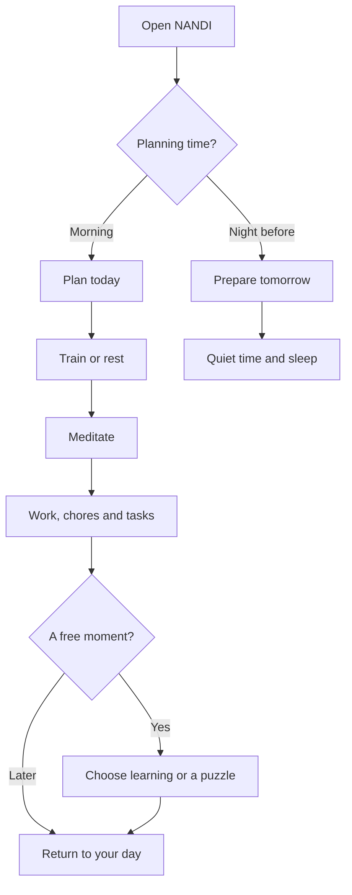

# NANDI basic app — agreed scope, 13 October 2026

NANDI helps connect everyday actions to the life a person wants. The exact promise and long-term goal model remain open. This build completes the basic daily routine in the existing offline app.

Mind, Learn, Train and Plan are permanent pillars. Now, Plan and You remain the three navigation tabs; You provides direct access to all four pillars.

| Pillar | Basic capabilities |
| --- | --- |
| Plan | Plan in the morning or prepare tomorrow at night; tasks and chores; a first step; focus timers; shutdown and weekly review. |
| Train | Existing placement, bodyweight or gym program, scheduled recovery, workout logging and history. |
| Mind | Short meditation with a saved timer; daily logic board and mystery; optional practice. |
| Learn | Choose existing topics, lessons or a learning track; saved progress and short reviews, during free time. |

This is a suggested order. Every card can be skipped; opening a pillar never requires completing the others. An unfinished focus, workout or meditation appears first in Now so the user can resume it. Night cards offer tomorrow's plan, meditation and lights-out. The deck ends without an extra-content invitation.

Today's progress shows completed tasks, logged training sessions, actual meditation time, solved puzzles and completed lessons or units. It does not claim a percentage of a dream goal or invent a competitive rank. A day still begins at 04:00.

## Data and behaviour

Meditation offers 2, 5 and 10 minutes. Its timestamps and pauses are saved locally; time is capped at the chosen duration. Finishing early records actual time. Returning after the deadline finishes the saved timer when the meditation screen opens. Closing the app does not promise an alarm or notification.

Meditation uses existing backed-up settings, with validation when reading restored values. Recording completion and clearing the active timer are one transaction. The database and backup format remain version 2. Updates wait for active meditation, including paused practice, and continue after its completion is saved.

The existing learning content is a starting catalogue: Gita, Charaka, people-reading reviews and the Drone technology pilot. More domains need authored, checked content. Offline features remain local; optional external lesson videos still need a connection.

## Next stages, after the basic app

1. Try this routine on the installed phone app, including offline reload, backup/restore and an update during a timer.
2. Choose the next learning topics from real use and add reviewed content packs.
3. Define the dream-goal model and feature selection controls from that use.
4. Develop advanced pillar capabilities, creator trials and the Premium offering.
5. Define Premium+ around external tools and agents, including the account/subscription model.

Subscriptions, AI orchestration, generated features, the creator marketplace and automatic increases in study duration are outside this basic build. This work does not merge the separate teaching-engine branch or close the existing device-validation phase.

## Phone delivery

The change is published as a review branch and pull request. It reaches the hosted app after merge to main and successful CI/deployment. A home-screen install of that web app should offer Update when online; its current update guard protects timers and writes. A packaged APK with bundled assets needs a separate build and installation. Do not uninstall or change its app origin to update it.
